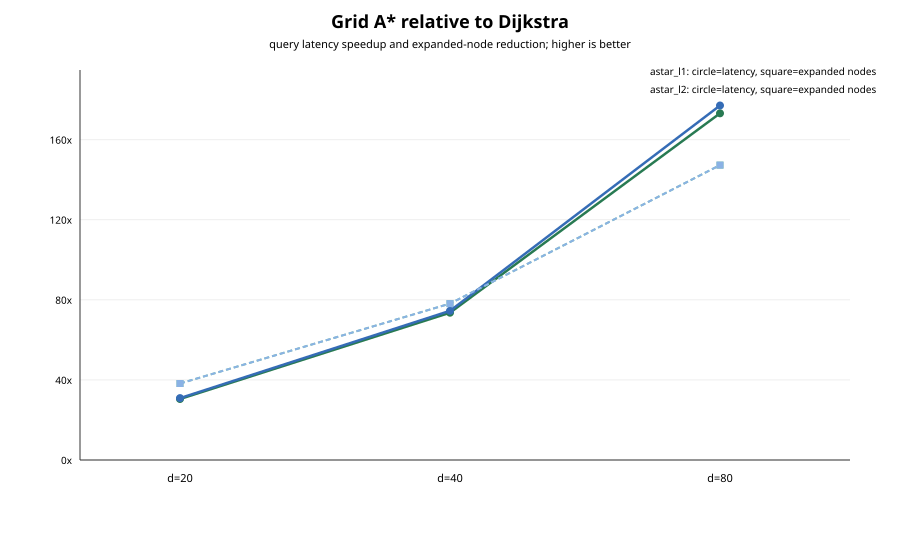
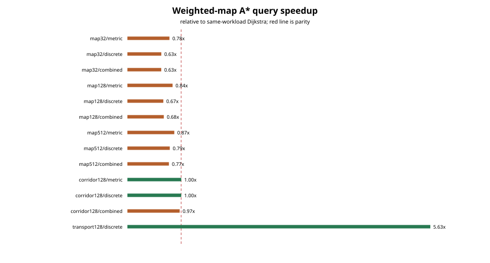
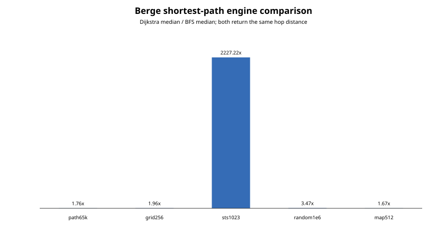

# Informed A* and Berge evidence closure

**Run date:** 2026-09-04 CEST

**Repository:** `hymeko/graph`

**Measured source:** `3d0dffbce5299a571a318f651d3958930c14a32b`

**Production fix:** `19876328bf39947c072c619938f79253b5ede455`

**Scope:** informed A*, unit-cost Berge shortest paths, and explicitly bounded Berge path/cycle
enumeration. D*/LPA* is not implemented and is not simulated by repeated A*.

## Executive verdict

The framework can be developed further on this base. There is no correctness or measurement-derived
blocker in the measured A*/Berge surface, and no core IR layout change is justified by these results.
The bounded enumerator did contain three real public-API defects; all three are corrected in one
production file without changing a public signature, type layout, dependency or Cargo manifest.

A* is strongly validated for optimality, but its speed is heuristic- and topology-dependent. Tight
Manhattan/Euclidean heuristics on the open grid reduce median query time by 30.48x to 177.09x. The
current heuristics on weighted obstacle maps expand exactly the same nodes as Dijkstra and are 1.15x
to 1.59x slower before preprocessing. The high-arity transport fixture is the useful counterexample:
prepared discrete-hop A* expands 2 rather than 16 nodes and is 5.63x faster per warm query, but its
795.874 microsecond preparation cost breaks even only after approximately 595 queries reusing the
same prepared goal table.

The public unit-cost Berge BFS is the right shortest-hop primitive: it is 1.67x to 3.47x faster than
unit-cost Dijkstra on four broad fixtures. Its 2,227x STS(1023) result is valid but topology-specific:
the goal is one hyperedge away, so BFS terminates immediately while Dijkstra resolves the dense
incidence space. Bounded path/cycle enumeration now reports why it stopped and preserves parallel
hyperarc identity; its results are suitable when callers treat a non-empty bound as an explicit
incompleteness signal.

As a measurement framework, this is approximately **9/10 mature for local workstation release
evidence**. It now combines fresh processes, raw wall/CPU samples, calibrated fast-operation batches,
quartiles and worst values, non-zero RSS, strong results hashed outside timing, deterministic work
counters, explicit preprocessing, semantic parity checks, a quiet-host gate, machine-readable
derived tables and frozen artifact hashes. The remaining major limitation is cross-host evidence;
the planned Kato rerun should close that gap. Hardware counters and longitudinal regression
thresholds are still absent.

## 1. Correctness repairs before measurement

Public-API probes reproduced three defects in `direct_ir::berge_enum` before the performance run:

1. Cycle deduplication keyed only the node ring, so cycles using different parallel hyperarcs
   collapsed. Three parallel rank-2 arcs returned one cycle instead of `C(3, 2) = 3`.
2. Reaching `max_depth` silently returned `bound = None`, making a truncated result look complete.
3. `max_results = 0` emitted one result before noticing the cap.

The repair canonicalizes the alternating `(node, outgoing hyperarc)` ring across every rotation and
both traversal directions. It therefore retains rotation/reflection deduplication while preserving
parallel-arc identity. Depth truncation is tracked independently and reported as `Depth` unless the
stronger global result or expansion cap stops the run. A zero result budget starts in the `Results`
state and emits nothing. Goal-directed path enumeration also stops recursing once the goal is
reached.

Regression tests pin all three contracts through public APIs. The full suite additionally retains
the independent linear-scan Dijkstra, exhaustive tiny Berge-path and BFS equivalence oracles already
used by informed search. No production source outside
`hymeko_graph/src/direct_ir/berge_enum.rs` changed.

## 2. Evidence integrity

The quiet-host run passed at 7% average and 10% maximum ambient CPU load. Every cell ran in a fresh
release process with two warmups and nine retained samples. Very fast cells were calibrated into
repeated-operation batches so the Windows process CPU clock remained measurable. Full result hashing
was performed by separate verification queries outside the timed boundary.

| Evidence population | Count | Validation |
|---|---:|---|
| Fresh child processes | 48 | all exit code 0; all external peak RSS non-zero |
| Summary cells | 48 | all `OK`; wall and CPU quartiles ordered |
| Raw measured samples | 432 | exactly nine per cell; every CPU value positive |
| Result rows | 48 | stable strong hash and semantic fields per cell |
| Search-work rows | 32 | 27 informed queries plus 5 unit-Dijkstra controls |
| RSS phase rows | 235 | all working-set and self-peak values positive |
| Derived comparison rows | 38 | 27 search, 5 shortest-path, 6 enumeration rows |

All informed subjects agree with their workload's Dijkstra result on reachability and exact
micro-cost. The metric heuristic can select a different equally optimal path on the weighted maps,
so path hashes are required to be stable per cell rather than artificially equal across algorithms.
All five BFS/Dijkstra pairs agree on reachability and hyperedge count. All 32 work rows report zero
reopenings. Every recorded TSV/SVG SHA-256 matches
[`artifact-sha256.tsv`](artifact-sha256.tsv), and all three SVGs parse as XML. The previous evidence
sets remain byte-identical at 10/10, 11/11 and 13/13 frozen hashes.

Exact host, toolchain, binary and command provenance is retained in
[`manifest.tsv`](manifest.tsv). The largest observed child-process peak was 274,001,920 bytes on
the map512 discrete-A* cell.

## 3. Informed-search result

### Tight grid heuristics

The 200 by 200 grid isolates heuristic information quality. Both admissible heuristics return the
same exact path, cost and hop count as Dijkstra and never reopen a node.

| Goal distance | Dijkstra median / expanded | A* L1 median / expanded | A* L2 median / expanded |
|---:|---:|---:|---:|
| 20 | 45.319 us / 802 | 1.487 us / 21 | 1.465 us / 21 |
| 40 | 238.428 us / 3,202 | 3.240 us / 41 | 3.199 us / 41 |
| 80 | 1,202.412 us / 11,931 | 6.943 us / 81 | 6.790 us / 81 |

The speedup increases with distance: L1 is 30.48x, 73.59x and 173.18x; L2 is 30.93x, 74.53x and
177.09x. This is genuine pruning rather than measurement noise: expanded-node reductions are
38.19x, 78.10x and 147.30x.



### Weighted maps and adversarial corridor

The weighted obstacle maps are a necessary negative result. Metric, discrete and combined A* all
settle the same number of nodes and resolve the same incidences as Dijkstra. Queue duplication rises
substantially, reaching 49,068 stale pops on map512, while reopenings remain zero.

| Workload | Dijkstra | Metric A* | Discrete A* | Combined A* | Discrete prep |
|---|---:|---:|---:|---:|---:|
| map32 | 58.434 us | 74.712 us | 92.628 us | 92.745 us | 30.031 us |
| map128 | 1.836 ms | 2.185 ms | 2.750 ms | 2.710 ms | 0.854 ms |
| map512 | 80.591 ms | 92.447 ms | 102.276 ms | 104.425 ms | 62.001 ms |
| corridor128 | 672.866 us | 671.897 us | 671.832 us | 692.080 us | 619.045 us |

There is no preprocessing break-even on the three maps because the warm discrete/combined query is
already slower than Dijkstra. The adversarial corridor correctly collapses all heuristics to roughly
Dijkstra behavior; discrete A* would amortize its preparation only after about 599 identical-table
queries, an immaterial 0.15% warm-query advantage.



### High-arity transport edge

The transport fixture demonstrates that the canonical hypergraph representation can support useful
informed pruning. Dijkstra takes 1.628 microseconds and expands 16 nodes; discrete A* takes 0.289
microseconds and expands 2. The 5.63x warm-query gain pays back 795.874 microseconds of heuristic
preparation after approximately 595 queries that reuse that table. For one-off or changing-goal
queries, Dijkstra remains faster end to end.

The operational policy should therefore be explicit: use Dijkstra as the robust default; enable A*
when the heuristic is proven admissible and informative for the topology; and account separately for
goal-table preparation and reuse.

## 4. Berge shortest-path result

The BFS and unit-cost Dijkstra calls use the same canonical `Ir` and incidence index. Their returned
paths can differ under equal-length ties, but reachability and hyperedge count agree exactly.

| Workload | Hops | BFS median | Dijkstra median | BFS speedup |
|---|---:|---:|---:|---:|
| path65k | 65,535 | 2.948 ms | 5.178 ms | 1.76x |
| grid256 | 510 | 8.550 ms | 16.761 ms | 1.96x |
| STS(1023) | 1 | 3.712 us | 8.267 ms | 2,227.22x |
| random1e6 | 9 | 21.708 ms | 75.254 ms | 3.47x |
| map512 | 1,022 | 39.918 ms | 66.692 ms | 1.67x |



This supports a simple API choice: use Berge BFS for unweighted minimum-hyperedge paths and reserve
Dijkstra/A* for actual weighted cost models. The STS ratio must not be generalized beyond direct
one-hop targets in dense high-arity structures.

## 5. Bounded path and cycle enumeration

These cells measure complete work only relative to the recorded finite budget. `Depth` and `Results`
mean the returned set is intentionally incomplete beyond that cap; `none` means the configured search
space completed.

| Workload / subject | Median | Items | Reported stop |
|---|---:|---:|---|
| layered10 / paths-to-goal | 189.857 us | 1,024 | depth 11 |
| grid6 / paths-to-goal | 61.164 us | 252 | depth 10 |
| grid5 / cycles | 106.938 us | 64 | depth 8 |
| STS(31) / all paths | 136.184 us | 4,096 | results 4,096 |
| STS(31) / cycles | 2.802 ms | 4,096 | results 4,096 |
| 16 parallel arcs / cycles | 63.231 us | 120 | complete |

The last row is the production regression at scale: all `C(16, 2) = 120` distinct two-arc cycles are
retained, while traversal rotations and reflections remain deduplicated. This closes the observed
identity bug. It is not a claim that arbitrary unbounded cycle enumeration is cheap; the API remains
combinatorial and should require finite budgets in production workflows.

## 6. D*/LPA* decision

There is no production D*, D* Lite or LPA* implementation in this repository. Repeated A* would not
reuse incremental search state, so reporting it as D* would be incorrect. This is not a blocker for
static pathfinding, but it remains a capability gap if the product needs changing edge costs or a
moving start.

The next approved design should choose from the actual workload:

- start with LPA* for a fixed start/goal regime with repeated external cost changes;
- choose D* Lite when the start moves while the graph/costs change; and
- require a typed change-set contract plus equivalence to a fresh Dijkstra result after every update.

That implementation should receive its own API and production approval rather than being folded into
this measurement-only scope.

## 7. Kato rerun contract

Run from the measured commit, or from a later commit whose diff touches only reports, with no other
benchmark workload active. Use a host-specific evidence directory:

```powershell
powershell -NoProfile -ExecutionPolicy Bypass -File scripts/informed_berge_evidence/run.ps1 `
  -RunDate "2026-09-04-kato-$env:COMPUTERNAME" `
  -ScratchRoot 'D:\hymeko-informed-berge-scratch'

powershell -NoProfile -ExecutionPolicy Bypass -File scripts/informed_berge_evidence/figures.ps1 `
  -RunDate "2026-09-04-kato-$env:COMPUTERNAME"
```

Do not pool raw samples from different machines. Compare cells by `(section, workload, subject)` and
report per-host median ratios with each host's Q1/Q3. Before accepting timing differences, require
identical reachability, cost, hops/item count, bound, checksum and deterministic work counters. Keep
the Kato manifest and artifact hashes beside its raw data. The quiet-host gate is deliberately enabled
in the command above.

## 8. Retained artifacts

- [`cells.tsv`](data/cells.tsv): all wall/CPU distribution summaries;
- [`samples.tsv`](data/samples.tsv): all 432 retained samples;
- [`results.tsv`](data/results.tsv): semantic outputs, hashes and enumeration bounds;
- [`search-work.tsv`](data/search-work.tsv): deterministic expansion and queue counters;
- [`search-comparison.tsv`](data/search-comparison.tsv): Dijkstra-relative A* and preparation rows;
- [`shortest-comparison.tsv`](data/shortest-comparison.tsv): BFS/Dijkstra shortest-path comparison;
- [`enumeration-summary.tsv`](data/enumeration-summary.tsv): bounded enumeration summary;
- [`processes.tsv`](data/processes.tsv) and [`rss.tsv`](data/rss.tsv): process and memory evidence;
- [`artifact-sha256.tsv`](artifact-sha256.tsv): frozen data and figure hashes; and
- [`manifest.tsv`](manifest.tsv): exact source, binary, host, toolchain and command provenance.

## 9. Repository gates and change boundary

The final tree passed:

- `cargo fmt --all -- --check`;
- workspace Clippy with all features and targets under `-D warnings`;
- workspace check and build with all features and targets;
- workspace tests with all features and targets;
- workspace doctests with all features; and
- separate benchmark-workspace no-run plus smoke execution of `graph_bench`, `incidence_bench`,
  `pgraph_bench` and `spine_bench`.

The all-target population has 568 names: 549 normal-policy passes and 19 deliberate measurement or
stress ignores. Doctest adds six names: four passes and two deliberate ignores. Combined, that is 574
names, 553 normal-policy passes and 21 documented ignores.

Relative to the approved base `7a4a9de40e02e654a990802c8cb636f24659ca91`, production changes are
confined to `hymeko_graph/src/direct_ir/berge_enum.rs`. The rest is the approved plan, regression and
evidence tests, shared measurement calibration cap, runner/figure scripts and this new evidence
directory. `hymeko_pgraph/src`, every Cargo manifest, `Cargo.lock`, the resolved core repository and
all prior evidence directories are unchanged.
