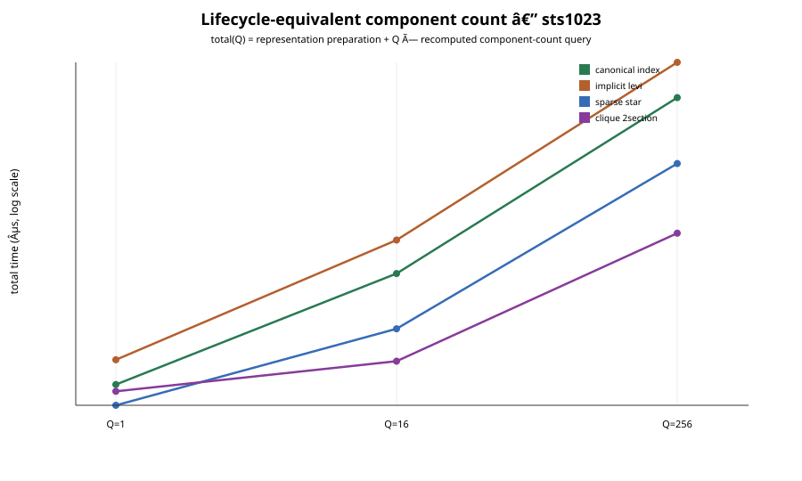
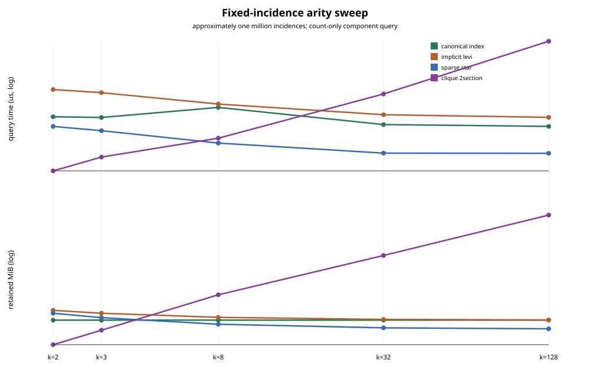

# Dijkstra and representation comparability closure

**Run date:** 2026-09-04 CEST

**Repository:** `hymeko/graph`

**Measured source:** `393978dc09e9a56fe8665c0c38c7c11f9b33a24b`

**Production fix:** `3b14899d0ed155c39372ac821abf52a067a05f16`

**Supersedes:** the Dijkstra checksum and representation-comparison conclusions in the
[first performance-evidence report](../2026-09-04/report.md). The earlier directory and
the historical P3.4 audit remain byte-identical.

## Executive verdict

There is no benchmark-derived blocker to continued framework development. The approved
minimal Dijkstra change removes a real high-degree quadratic scan without changing the
public API, graph semantics, path result, topology ownership, dependency graph or core IR
layout. In a sequential pre/post diagnostic using the same release harness it reduced
median Dijkstra latency on all five workloads; STS(1023), the deliberately high-degree
case, improved from 26.553 ms to 8.858 ms (3.00x). Full path hashes and all search-work
counters remained identical.

The representation experiment is now like-for-like. Every variant recomputes only the
global canonical-node component count from a prepared representation into reusable
workspace. The canonical control no longer constructs a complete component labeling.
An additional fixed-incidence arity sweep exposes the expected boundary: clique is
attractive only for this lossy query at small arity, while its retained memory grows to
514.29 MiB at arity 128; sparse star becomes the strongest lossy control from arity 8.
This is evidence about one query, not a recommendation to replace canonical IR.

As a measurement framework, this is approximately **8.5/10 mature** for workstation
release evidence. It now has raw samples, distribution summaries, explicit operation and
process scopes, full-result checksums, deterministic algorithm-work counters, comparable
representation lifecycles, retained-byte accounting, adversarial arity coverage, a quiet
host gate and frozen hashes. The remaining limits are one Windows host, no hardware
counters, no cross-host regression thresholds and the previously documented core-owned
isolated benchmark gaps.

## 1. Evidence contract and integrity

The quiet-host run used two warmups and nine retained samples per successful cell. The
ambient CPU gate passed at 10.8% average and 23% maximum. Exact host, toolchain, workload,
seed, binary and command provenance is in [`manifest.tsv`](manifest.tsv).

| Evidence population | Count | Validation |
|---|---:|---|
| Fresh child processes | 75 | all exit code 0; all external peak RSS non-zero |
| Summary cells | 107 | 105 `OK`, 2 explicit rank-2 `NA` |
| Raw measured samples | 945 | exactly nine per `OK` cell |
| Representation rows | 32 | four variants for eight workloads |
| Fixed-incidence arity rows | 20 | four variants for each of five arities |
| Dijkstra work rows | 5 | non-zero work; zero reopenings |

Every successful summary satisfies `Q1 <= median <= Q3 <= worst`; checksums are stable
within cells; all four representations agree on the component count for each workload;
and every recorded TSV/SVG SHA-256 matches
[`artifact-sha256.tsv`](artifact-sha256.tsv). All SVGs parse as XML. The prior evidence
set still matches 10/10 frozen hashes and the independent P3.4 audit still matches 11/11.

## 2. Minimal Dijkstra production repair

`IncidenceIndex` already stores aligned `incident_arcs(node)` and
`incident_slots(node)` rows. The previous loop enumerated the arc row and called
`u_slot_in` for every arc, linearly rescanning the same row to recover its slot. That
introduced a `sum(degree^2)` term. On STS(1023), the diagnostic counted 57,303,686 slot
comparisons for 348,502 resolved incidences, or 164.43 comparisons per resolution.

The production change zips the two existing slices and passes the matching entry slot
directly to `resolve`. It is four added and seventeen removed lines in
`hymeko_graph/src/direct_ir/informed.rs`; the obsolete helper is gone. There is no new
allocation, cache, type, signature or ordering rule.

The paired figures below were collected immediately before and after that source change,
with the same release harness, two warmups and nine samples per side. They are a local
sequential diagnostic rather than the quiet-host baseline; their full Q1/Q3/worst values
and provenance are retained in [`dijkstra-pre-post.tsv`](data/dijkstra-pre-post.tsv).

| Workload | Before median | After median | Speedup | Latency reduction |
|---|---:|---:|---:|---:|
| path65k | 6.324 ms | 5.907 ms | 1.071x | 6.6% |
| grid256 | 17.174 ms | 16.436 ms | 1.045x | 4.3% |
| STS(1023) | 26.553 ms | 8.858 ms | 2.998x | 66.6% |
| random1e6 | 87.925 ms | 76.439 ms | 1.150x | 13.1% |
| map512 | 86.656 ms | 80.196 ms | 1.081x | 7.5% |

The quiet-host post-fix Dijkstra medians are 6.537, 16.615, 8.820, 108.730 and
87.234 ms in the same workload order. The random and map distributions are visibly
wider in this run, so the report retains their quartiles rather than deriving a second
pre/post claim from independently scheduled sessions.

The checksum is now `WeightedBergePath::path_hash()`, computed by one verification query
outside each timed sample. Timing therefore covers path search, not post-search hashing.
The five before/after path hashes and all `SearchStats` fields match exactly:

| Workload | Expanded nodes | Expanded arcs | Resolved incidences | Pushes | Pops | Stale | Reopened |
|---|---:|---:|---:|---:|---:|---:|---:|
| path65k | 65,536 | 65,535 | 65,535 | 65,536 | 65,536 | 0 | 0 |
| grid256 | 65,536 | 130,560 | 130,560 | 65,536 | 65,536 | 0 | 0 |
| STS(1023) | 1,023 | 174,251 | 348,502 | 1,023 | 1,023 | 0 | 0 |
| random1e6 | 104,301 | 186,947 | 373,894 | 118,060 | 104,301 | 0 | 0 |
| map512 | 261,736 | 521,632 | 521,632 | 261,838 | 261,838 | 102 | 0 |

This invariance is the critical semantic check: the optimization removes redundant slot
lookup work but does not alter the explored search, queue behavior or returned path.

## 3. Corrected representation comparison

The original representation run was not a fair query comparison: the public canonical
path produced a full `ComponentLabeling`, while the controls produced only a count. The
corrected benchmark uses a test-only count-only DSU control that scans borrowed canonical
arcs. All variants reserve and reuse query workspace, return one `usize`, do not read a
cached result, and expose representation/workspace/output retained bytes separately.

On the original workloads, sparse star remains favorable for this component-count query.
Implicit Levi is never better than the corrected canonical control. Clique has a fast
warm query but its preparation and semantic loss matter.

| Workload | Representation | Prep | Warm query | First-query total verdict |
|---|---|---:|---:|---|
| STS(1023) | canonical | 14.254 ms | 5.690 ms | baseline |
|  | implicit Levi | 19.236 ms | 9.668 ms | never better |
|  | sparse star | 12.524 ms | 2.091 ms | always better |
|  | clique 2-section | 17.339 ms | 0.685 ms | better from Q=1 |
| random1e6 | canonical | 35.933 ms | 14.689 ms | baseline |
|  | implicit Levi | 49.154 ms | 26.837 ms | never better |
|  | sparse star | 36.517 ms | 8.976 ms | better from Q=1 |
|  | clique 2-section | 41.510 ms | 4.381 ms | better from Q=1 |
| map512 | canonical | 33.477 ms | 12.218 ms | baseline |
|  | implicit Levi | 45.020 ms | 24.176 ms | never better |
|  | sparse star | 32.261 ms | 5.396 ms | always better |
|  | clique 2-section | 45.746 ms | 1.622 ms | better from Q=2 |

Only canonical reports no semantic loss. Implicit Levi, sparse star and clique discard
different combinations of signs, weights, paths, hyperarc identity, cardinality or exact
incidence slots. Their results cannot support a core layout switch.

## 4. Fixed-incidence arity sweep

The five synthetic workloads hold canonical nodes at 200,000 and incidences at exactly
or just below one million: 1,000,000 for arities 2, 8 and 32; 999,999 for arity 3; and
999,936 for arity 128. This separates arity effects from a growing incidence count.

| Arity | Canonical query / retained | Sparse-star query / retained | Clique query / retained |
|---:|---:|---:|---:|
| 2 | 14.861 ms / 14.50 MiB | 11.304 ms / 18.31 MiB | 3.191 ms / 6.29 MiB |
| 3 | 14.584 ms / 14.50 MiB | 10.004 ms / 15.77 MiB | 4.721 ms / 10.29 MiB |
| 8 | 19.428 ms / 14.50 MiB | 7.035 ms / 12.59 MiB | 8.094 ms / 34.29 MiB |
| 32 | 11.925 ms / 14.50 MiB | 5.282 ms / 11.16 MiB | 28.466 ms / 130.29 MiB |
| 128 | 11.308 ms / 14.50 MiB | 5.258 ms / 10.80 MiB | 127.555 ms / 514.29 MiB |

The observed boundary matches the structural costs. Clique is compact and fast at arity
2, still query-fast at 3 and 8, then loses both time and memory as pair expansion grows.
Sparse star is the strongest lossy count-only control from arity 8 onward, including
preparation and retained bytes. Implicit Levi is never fastest and approaches canonical
retained size only at high arity. Exact values for all four representations are in
[`arity-sweep.tsv`](data/arity-sweep.tsv).

## 5. What this changes—and what it does not

The corrected evidence supports three bounded conclusions:

1. The Dijkstra slot rescan was a production defect worth fixing; the minimal zip repair
   preserves exact results and improves every paired workload, especially high degree.
2. Sparse star is a useful specialized control for component counting, particularly at
   arity 8 and above. It is not a semantically equivalent replacement for canonical IR.
3. Clique's low-arity query speed cannot be generalized: high arity makes its quadratic
   storage and build/query cost explicit.

No core repository file or IR layout was changed. No Cargo manifest, lockfile, public API
or production file outside the single approved graph source was changed. The independent
batch-scaling evidence remains workload-specific; this follow-up does not relabel it as
single-query parallelism.

## 6. Retained artifacts

- [`cells.tsv`](data/cells.tsv): all operation and representation summaries;
- [`samples.tsv`](data/samples.tsv): all 945 measured samples;
- [`search-work.tsv`](data/search-work.tsv): deterministic Dijkstra work counters;
- [`representations.tsv`](data/representations.tsv): retained-byte accounting;
- [`representation-totals.tsv`](data/representation-totals.tsv): repeated-query totals;
- [`arity-sweep.tsv`](data/arity-sweep.tsv): fixed-incidence arity comparison;
- [`processes.tsv`](data/processes.tsv) and [`rss.tsv`](data/rss.tsv): process evidence;
- [`artifact-sha256.tsv`](artifact-sha256.tsv): frozen data and figure hashes.

## 7. Repository gates and change boundary

The final tree passed:

- `cargo fmt --all -- --check`;
- workspace Clippy with all features and targets under `-D warnings`;
- workspace check and build with all features and targets;
- workspace tests with all features and targets;
- workspace doctests with all features; and
- separate benchmark-workspace no-run plus smoke execution of `graph_bench`,
  `incidence_bench`, `pgraph_bench` and `spine_bench`.

The population is reported without mixing scopes: all-target has 559 named tests (544
normal-policy passes and 15 deliberate ignores), while doctest has six names (four passes
and two deliberate ignores). Combined, that is 565 names, 548 normal-policy passes and
17 documented ignores.

Relative to the approved follow-up base `c4bc981`, production changes are confined to
`hymeko_graph/src/direct_ir/informed.rs`. The rest is the approved plan, test harness,
runner/figure scripts and new dated evidence directory. `hymeko_pgraph/src`, every Cargo
manifest, `Cargo.lock`, the resolved core repository and the prior evidence directories
are unchanged.
