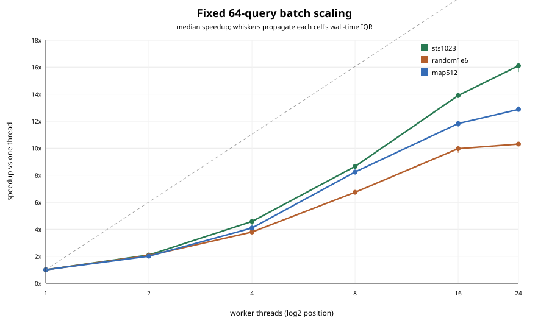
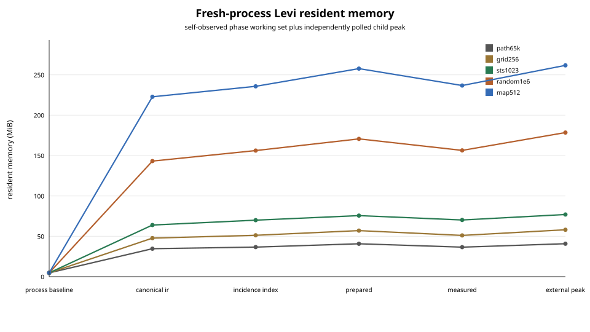
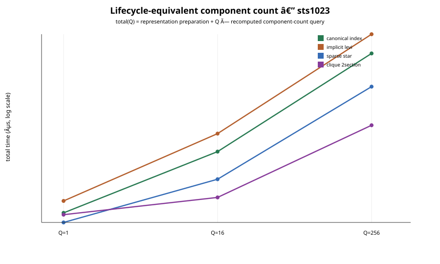

# Graph performance evidence

**Run date:** 2026-09-04 CEST

**Repository:** `hymeko/graph`

**Evidence binary source:** `d06465a6c92fbbde9d6a94c2cbede6efea4411e6`

**Historical provenance:** follow-up to the independent P3.4 audit

## Executive verdict

The graph framework is fit for continued development. Its semantic and ownership core
was already substantially sound; this run raises the performance-evidence layer from an
audit-grade diagnosis to a repeatable, release-usable baseline. On this host the current
measurement system is approximately **8/10 mature**: raw samples, distributions,
operation/process scopes, checksums, phase RSS, lifecycle-equivalent controls and pinned
IR ownership are now explicit and reproducible.

The remaining two points are deliberate limits, not hidden zeros: this is one
non-laboratory Windows host without hardware counters, and the public graph API does not
expose retained bytes for the canonical traversal workspace. Core IR also still lacks
isolated owner benchmarks for incident-arc lookup, exact incidence resolution and path
index operations.

The strongest measured result is 64-query batch throughput, not single-query
parallelism. At 24 threads the median speedups are 16.11x for STS(1023), 10.30x for the
one-million-incidence random workload and 12.87x for map512. These results support
building on the framework, but they do not establish universal acceleration for every
graph shape, query or machine.

## 1. Evidence contract and population

The stable suite is named `performance_evidence`; the roadmap code appears only as
historical provenance. Every successful cell uses two warmups and nine retained
samples, reporting median, Q1, Q3 and worst. Fast operations are repeated until a
250 ms target and normalized, preventing the Windows process-CPU clock quantum from
being presented as zero-time precision.

The run passed a quiet-host gate at 4.6% average and 11% maximum ambient CPU. It used
rustc/cargo 1.97.1 on Windows 11 Home build 26200, an Intel Core Ultra 9 275HX, 24
logical processors and 63.42 GiB RAM. Full provenance and exact commands are in
[`manifest.tsv`](manifest.tsv).

| Evidence population | Count | Result |
|---|---:|---|
| Fresh child processes | 55 | all exit code 0 |
| Summary cells | 67 | 65 `OK`, 2 explicit `NA` |
| Raw measured samples | 585 | nine per `OK` cell |
| RSS phase observations | 261 | no successful non-empty zero-RSS process |
| Representation comparisons | 12 | all answer checksums agree per workload |
| Core IR coverage rows | 24 | owner, composite, gap or unsupported made explicit |

The two `NA` cells are rank-2 on STS(1023) and random1e6: those workloads contain
multiway hyperarcs, while graphic rank-2 intentionally requires cardinality two. The
runner fails on a missing cell, child failure, checksum drift, invalid quartile order,
wrong sample count or zero process RSS; `NA` cannot silently become a numeric result.

Raw and summarized evidence is retained in
[`samples.tsv`](data/samples.tsv), [`cells.tsv`](data/cells.tsv),
[`processes.tsv`](data/processes.tsv), [`rss.tsv`](data/rss.tsv) and
[`representations.tsv`](data/representations.tsv). SHA-256 values for every TSV and SVG
are frozen in [`artifact-sha256.tsv`](artifact-sha256.tsv).

## 2. Independent-query batch scaling

Each scaling cell runs the same fixed batch of 64 independent, internally serial
reachability queries. The query set, graph and checksum are identical at all thread
counts. Speedup is the one-thread median divided by the matching thread-count median.

| Workload | 1 thread median | 24 threads median | Speedup | Efficiency | Busy cores |
|---|---:|---:|---:|---:|---:|
| STS(1023) | 383.983 ms | 23.840 ms | 16.11x | 67.1% | 17.97 |
| random1e6 | 3,244.324 ms | 314.860 ms | 10.30x | 42.9% | 19.70 |
| map512 | 2,075.258 ms | 161.230 ms | 12.87x | 53.6% | 18.66 |



The quiet-host rerun reproduces the original STS 16.1x headline and supports the
roughly 9.9x random headline, while map512 is 12.87x rather than 13.6x. Values above
linear efficiency at a few low thread counts are cache/scheduling effects and ordinary
workstation noise; they are not treated as superlinear algorithmic scaling. Most
importantly, none of these numbers is relabeled as acceleration of one query.

## 3. Serial operation baseline

The following are median operation-scope wall times. CPU deltas are measured over the
same operation boundary; single-thread busy-core ratios cluster near one after batching.

| Workload | Reachable | Components | Dijkstra | Rank-2 | Levi rank |
|---|---:|---:|---:|---:|---:|
| path65k | 1.359 ms | 1.695 ms | 6.476 ms | 0.627 ms | 1.065 ms |
| grid256 | 6.830 ms | 7.380 ms | 16.997 ms | 3.081 ms | 4.439 ms |
| STS(1023) | 4.971 ms | 4.978 ms | 26.114 ms | `NA` | 8.560 ms |
| random1e6 | 49.181 ms | 50.946 ms | 85.906 ms | `NA` | 25.109 ms |
| map512 | 34.389 ms | 36.383 ms | 84.687 ms | 15.677 ms | 23.058 ms |

Rank-2 is approximately 9.56 ns/arc on path65k and 23.60 ns/arc on grid256. Levi rank
is approximately 16.37 ns/incidence on STS(1023) and 25.11 ns/incidence on random1e6.
These are host-specific medians with full IQR/worst data, not API latency guarantees.

## 4. CPU and memory boundaries

Operation CPU and operation wall are sampled inside the test cell. Whole-child wall,
CPU and peak RSS are recorded separately by the runner. CPU values are never divided
across those two scopes. The child also emits working-set milestones at process
baseline, canonical IR creation, incidence-index creation, prepared state and measured
state.

| Levi workload | Baseline | Canonical IR | Index | Prepared | Whole-child peak |
|---|---:|---:|---:|---:|---:|
| path65k | 4.76 MiB | 34.66 MiB | 36.66 MiB | 40.76 MiB | 40.80 MiB |
| grid256 | 4.76 MiB | 47.74 MiB | 51.23 MiB | 57.06 MiB | 58.07 MiB |
| STS(1023) | 4.76 MiB | 63.96 MiB | 69.95 MiB | 75.64 MiB | 76.96 MiB |
| random1e6 | 4.76 MiB | 143.19 MiB | 156.16 MiB | 170.63 MiB | 178.50 MiB |
| map512 | 4.76 MiB | 222.77 MiB | 235.71 MiB | 257.68 MiB | 261.75 MiB |



This repairs the previous all-zero peak-RSS evidence. The self-reported process peak
and independently polled child peak agree at the relevant long-running cells. External
polling can miss a short-lived peak: nine fast cells had a lower external value, with
the largest 6.3 MiB gap on an early-exit `NA` rank-2 cell. The TSV retains both values;
neither is backfilled from the other. Phase RSS is process working set, so allocator
retention and shared pages prevent interpreting phase differences as exact object-size
allocations.

## 5. Lifecycle-equivalent representations

All four test-only representations answer exactly one question: recompute the global
canonical-node component count from a prepared representation into reused workspace.
Preparation builds the representation and reserves the workspace; queries do not read
a count cached during preparation. Typed keys prevent prose-only identity:
`canonical_index`, `implicit_levi`, `sparse_star` and `clique_2section`.

| Workload | Representation | Prep | Warm query | Result versus canonical total |
|---|---|---:|---:|---|
| STS(1023) | canonical index | 12.923 ms | 4.983 ms | baseline |
|  | implicit Levi | 16.282 ms | 8.362 ms | never better |
|  | sparse star | 11.828 ms | 2.020 ms | better from first query |
|  | clique 2-section | 16.381 ms | 0.669 ms | better from first query |
| random1e6 | canonical index | 72.379 ms | 51.387 ms | baseline |
|  | implicit Levi | 46.441 ms | 24.336 ms | better from first query |
|  | sparse star | 33.880 ms | 8.900 ms | better from first query |
|  | clique 2-section | 39.296 ms | 4.197 ms | better from first query |
| map512 | canonical index | 57.412 ms | 37.024 ms | baseline |
|  | implicit Levi | 42.585 ms | 20.746 ms | better from first query |
|  | sparse star | 30.306 ms | 5.330 ms | better from first query |
|  | clique 2-section | 44.111 ms | 1.609 ms | better from first query |



This replaces the old invalid break-even comparison; it does not retrofit validity onto
the historical numbers. It also does not recommend clique as a general replacement.
Clique is especially fast for this one component-count question but loses hyperarc
identity, cardinality, signs, weights and exact incidence slots. Sparse star and Levi
also have explicitly recorded semantic losses. Only canonical index reports no loss.

Retained representation, workspace and output bytes are separate in the TSV. The
canonical traversal workspace remains `UNMEASURED` because the public API exposes no
stable capacity/size accessor; therefore total retained-memory rankings are not claimed.

## 6. Core-owned IR evidence

Canonical IR remains owned by `hymeko/core`. No graph-local copy of its benchmarks was
added. The exact resolved revision `70b4f364d9559602d2d229cde5bfe0d8b8cc5113`
was checked out detached and its owner benchmark was smoke-run successfully:

```text
cargo bench -p hymeko_core --bench ir_bench -- --test
```

The resulting benchmark binary hash is in the manifest. The 24-row
[`core-ir-coverage.tsv`](data/core-ir-coverage.tsv) distinguishes owner-measured,
composite-only, unmeasured and unsupported operations. Construction, canonical lookup,
mapping, hierarchy traversal, hashing, clone and serde have owner benchmarks. Incident
arc lookup, exact incidence-coordinate resolution and path-index build/lookup remain
unmeasured in isolation. Canonical deletion and transactional in-place update are not
implemented, so no timing is fabricated.

## 7. Effect on the independent audit

The historical audit and its artifacts remain unchanged. This evidence updates the
measurement situation as follows:

| Previous finding | Current evidence |
|---|---|
| Peak RSS was all zero | corrected with phase RSS, self peak and external child peak |
| CPU mixed process lifetime with one-operation wall | corrected with separate operation and process scopes |
| Batch cells had only three measured samples | corrected to nine raw samples plus median/IQR/worst |
| Representation break-even used unlike lifecycles | replaced by one question and equal preparation/query lifecycle |
| Levi query was a cached scalar | every control now recomputes the result |
| Representation identity was prose | replaced by stable typed keys and recorded semantic loss |
| Graph duplicated incomplete IR measurement ownership | replaced by pinned core-owner inventory and explicit gaps |

No new production algorithm, public API, dependency or topology authority was introduced.
The suite is a client and independent control layer. The original audit's semantic
verdicts and production fixes therefore stand; only its measurement deficiencies are
closed or narrowed here.

## 8. Repository gates and immutability

The final tree passed:

- `cargo fmt --all -- --check`;
- workspace Clippy with all features and targets under `-D warnings`;
- workspace check and build with all features and targets;
- workspace tests with all features and targets;
- workspace doctests with all features; and
- separate benchmark-workspace no-run plus smoke execution of `graph_bench`,
  `incidence_bench`, `pgraph_bench` and `spine_bench`.

The resulting all-target population is 562 named tests, including five helper tests
compiled through an example target: 545 pass under normal policy and 17 are deliberately
ignored measurement, stress, golden-generation or documentation cases. The six new
names account for four passing contract/parity tests and two ignored fresh-process cells.

Relative to the approved base `2247f2d`, there is no change under `hymeko_graph/src`,
`hymeko_pgraph/src`, any Cargo manifest or `Cargo.lock`. All 11 frozen historical P3.4
artifact hashes still match. The performance suite, scripts and reports are therefore
strictly test/evidence additions.

## 9. Remaining limits and next actions

No blocking remediation is required before continuing framework work. The next useful
measurement investments are narrower:

1. add core-owned isolated benchmarks for incidence-index construction/validation,
   incident-arc lookup, exact incidence resolution and path-index operations;
2. expose a stable retained-capacity report for canonical traversal workspace if total
   memory comparison becomes a product decision;
3. rerun this dated suite on CI reference hardware or a second machine before turning
   host-specific medians into release thresholds;
4. add hardware counters only when cache, bandwidth or branch behavior becomes an
   optimization decision; and
5. create a distinct benchmark if true intra-query parallelism is implemented.

Until then, the defensible statement is: graph has strong correctness evidence and good
parallel throughput for independent query batches, with repeatable operation/memory
baselines and clearly bounded representation experiments. It is ready to build on;
performance claims should remain workload- and scope-specific.
